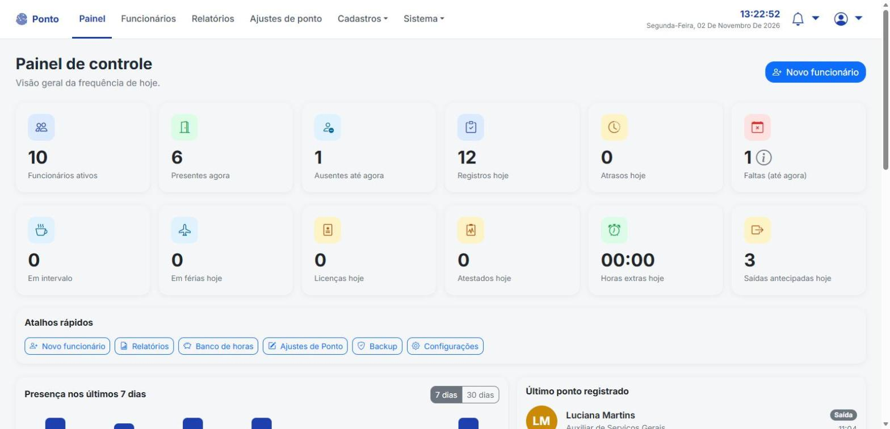
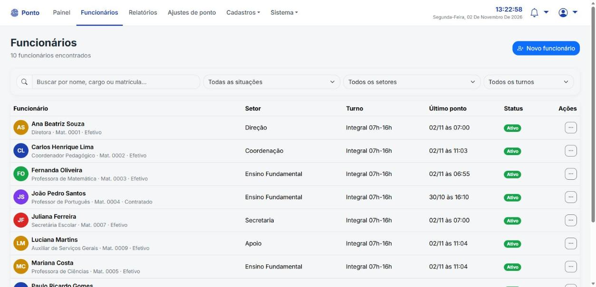
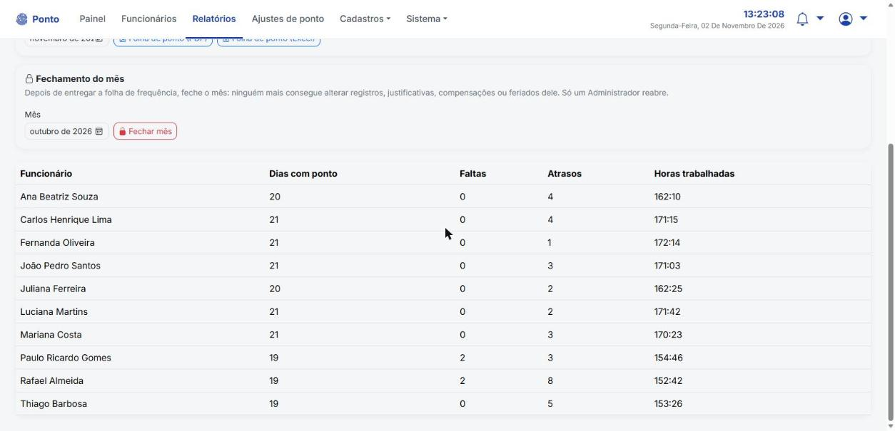
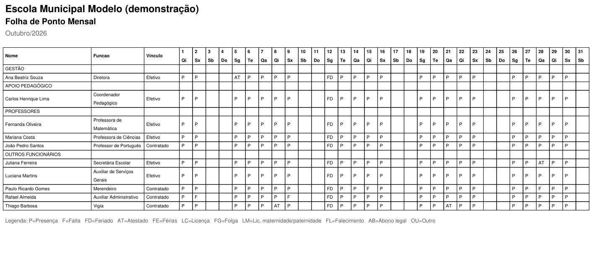

# SIGEP — Sistema de Gestão de Ponto

Sistema de ponto eletrônico feito para uma **escola municipal de Tonantins (AM)**, onde os funcionários ainda assinavam o ponto num **caderno**. Agora cada um aproxima o crachá com QR Code da câmera do totem, e o sistema grava a data e a hora reais e calcula atrasos, faltas e horas trabalhadas. A folha de ponto do mês sai pronta em PDF ou Excel.

Ele roda **no computador da escola, sem internet**, porque no interior do Amazonas a conexão cai com frequência. A instalação também é offline: as dependências ficam na pasta `wheels/`.

> Todas as imagens abaixo usam **dados fictícios** (`demo_seed.py`). Nenhum dado real da escola está neste repositório.

| Totem | Painel |
|---|---|
|  |  |

| Funcionários | Relatório do mês |
|---|---|
|  |  |

**Folha de ponto mensal (PDF)**, no modelo que a secretaria já usava em papel:



## Funcionalidades

**Totem**
- Leitura do crachá pela câmera (QR Code), alternando sozinho entre entrada e saída
- Foto no momento da batida, para conferência
- Só aparelhos autorizados funcionam como totem. Isso impede que alguém bata o ponto pelo celular usando a foto de um crachá. Cada aparelho tem a própria chave, e um tablet perdido pode ser revogado em Configurações sem afetar os outros
- Funciona num tablet pela rede Wi-Fi da escola

**Gestão**
- Funcionários, setores, turnos (com intervalo de almoço e tolerância), escalas e feriados
- Ausências e justificativas (atestado, férias, licença...) com documento anexado
- Banco de horas com compensações
- Ajustes de ponto com justificativa, sempre registrados na auditoria
- Crachá com QR Code pronto para imprimir

**Relatórios**
- Painel do dia: quantos estão presentes, quem ainda não chegou (e quem já passou do horário), atrasos e as últimas batidas
- Relatório por período, histórico por funcionário e espelho de ponto
- Folha de ponto mensal agrupada por categoria (gestão, apoio pedagógico, professores, outros)
- Exportação em PDF, Excel e CSV
- **Fechamento do mês**: depois de entregue a folha, ninguém altera mais nada daquele mês (travado por triggers no banco)

**Segurança e operação**
- Quatro perfis de acesso: Administrador, RH, Direção e Consulta
- Senhas com hash, proteção CSRF e bloqueio após tentativas erradas de login
- Troca obrigatória da senha padrão no primeiro acesso
- Auditoria de todas as alterações
- Backup automático a cada hora e restauração pelo painel

## Tecnologias

 


Flask + SQLite, servido pelo Waitress. PDFs com fpdf2, planilhas com openpyxl, QR Code com qrcode e leitura no navegador com jsQR.

## Organização do código

```
app.py                 ponto de entrada (python app.py ou waitress app:app)
nucleo.py              app Flask, segurança (login, perfis, CSRF), auditoria e backup automático
rotas/
  totem.py             leitura do crachá e fotos da batida
  acesso.py            login, painel e troca de senha
  funcionarios.py      cadastro, documentos, crachá, histórico, banco de horas e ausências
  cadastros.py         setores, turnos, escalas e feriados
  relatorios.py        relatórios, exportações, ajustes de ponto e fechamento do mês
  sistema.py           configurações, usuários, auditoria e backup
db.py                  banco SQLite, migrações e travas do mês fechado
relatorios_service.py  cálculo de atrasos, faltas, horas e banco de horas
exportadores.py        PDF e Excel
templates/, static/    telas (Jinja + Bootstrap)
tests/                 testes automatizados (pytest)
```

## Como experimentar

```bash
git clone https://github.com/anndreluizz/sistema-de-ponto.git
cd sistema-de-ponto
python -m venv venv
venv\Scripts\activate          # Linux/Mac: source venv/bin/activate
pip install -r requirements.txt
python demo_seed.py            # cria um banco com uma escola e funcionários fictícios
python app.py
```

Abra http://127.0.0.1:5000. A área administrativa fica na engrenagem do canto inferior direito. Login de demonstração: `admin` / `demo1234`.

Para instalar de verdade numa escola, sem internet, basta dar dois cliques no `iniciar.bat`. O passo a passo completo para quem vai usar está no [LEIAME.txt](LEIAME.txt).

## Testes

```bash
pip install -r requirements-dev.txt
pytest
```

São 72 testes: rotas, login, CSRF, perfis de acesso, exportações e os cálculos de atraso, falta, feriado e horas trabalhadas.

## Autor

**André Luís Coelho Lopes**: [LinkedIn](https://www.linkedin.com/in/andre-luis-coelho-lopes) · [GitHub](https://github.com/anndreluizz)

Também desenvolvi o [Vertex ERP](https://github.com/anndreluizz/VertexERP), sistema de gestão em uso numa loja de varejo com matriz e filial.
